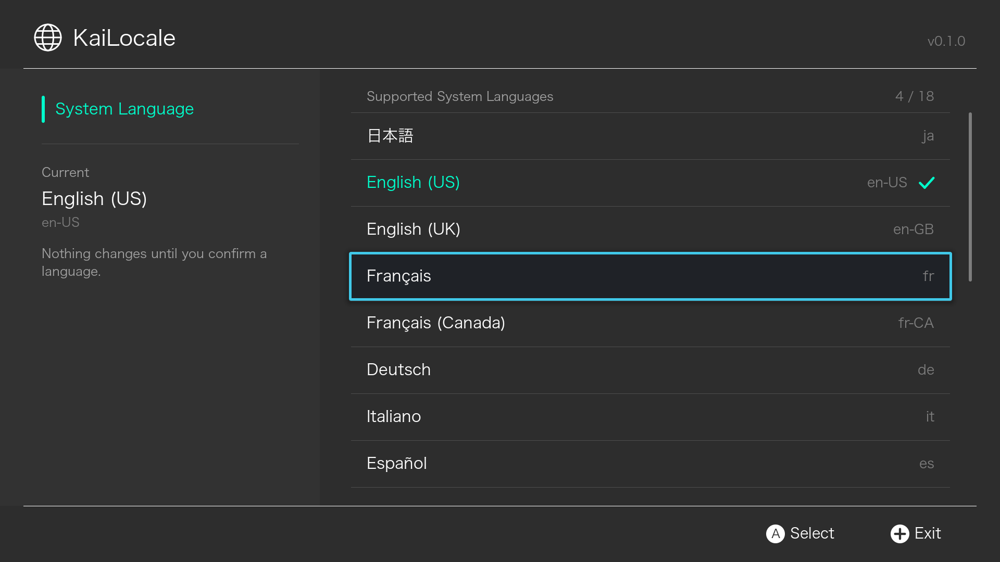
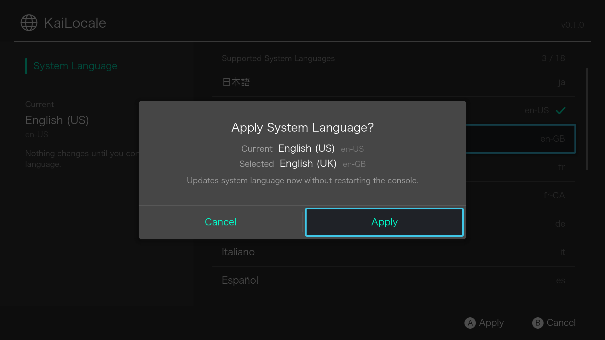
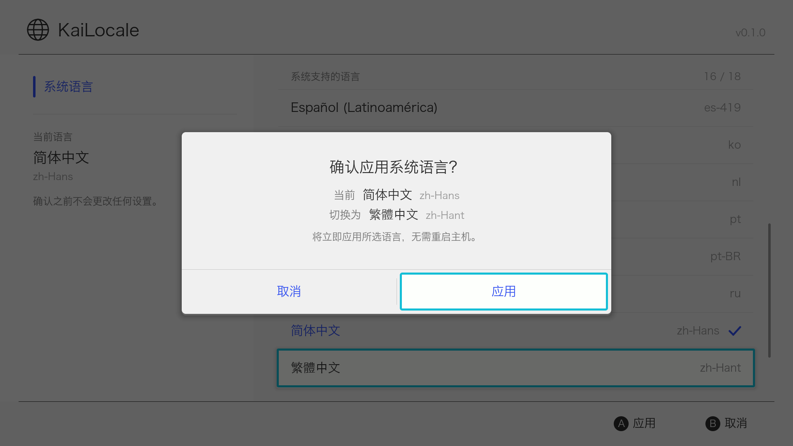

# KaiLocale

KaiLocale is a native system language switcher for Switch 2 consoles running kaiHEN. It provides a single controller-first picker to inspect the current system language, browse supported Horizon OS languages in their native scripts, and apply a change after explicit confirmation.

The project is still experimental. KaiLocale works completely offline, installs no background services, and only updates the confirmed system language without modifying region, account, firmware, or save data.

## Features

- **Single `hbmenu` entry:** One native Switch 2 NRO (`switch/KaiLocale/KaiLocale.nro`) instead of 18 separate language NROs.
- **Runtime language discovery:** Reads supported Horizon OS BCP-47 tags directly via `libounce` (`set` / `set:sys`) while excluding Switch 1 legacy read-only compat tags (`zh-CN`, `zh-TW`).
- **Multilingual rendering:** Displays Latin, Cyrillic, Japanese, Korean, Simplified Chinese, Traditional Chinese, and Thai autonyms via `pl:u` shared system fonts and bundled OFL-1.1 Noto fallbacks.
- **Safe confirmation & readback:** Read-only while browsing, no-op when selecting the active language, and verifies applied changes via `setGetLanguageCode()` readback.

## Screenshots

| Language List (Dark) | Confirmation Dialog (Dark) | Confirmation Dialog (Light, 中文) |
|---|---|---|
|  |  |  |

## Requirements

- Nintendo Switch 2 kaiHEN (verified on firmware `23.0.1`, `kaiHEN 20261117.1`)

## Installation

1. Download `KaiLocale-v0.1.0-sd.zip` (or `KaiLocale.nro`) and `SHA256SUMS` from the [latest release](https://github.com/thedavidweng/kailocale/releases), and optionally verify with `sha256sum -c SHA256SUMS`.
2. Extract the archive to the root of your SD card—or copy `KaiLocale.nro` directly—so it sits at `sdmc:/switch/KaiLocale/KaiLocale.nro`.
3. Start kaiHEN, open `hbmenu`, and launch KaiLocale.

To uninstall, delete `sdmc:/switch/KaiLocale/` from your SD card.

## Controls & Behavior

| Input | Action |
|---|---|
| **D-pad / Left Stick Up & Down** | Move focus |
| **A** | Open confirmation / confirm switch |
| **B** | Cancel / back (leaves language untouched) |
| **Plus (`+`)** | Exit to `hbmenu` |
| **Touch** *(Handheld)* | Tap to focus/confirm; drag vertically to scroll |

- **Immediate vs. HOME Menu effect (`23.0.1`):** System Settings and newly launched / in-game languages update immediately; the HOME Menu UI language does not change dynamically without a reboot or session reload, and already-running apps must be reopened.
- **Reboot persistence:** Not tested in the `v0.1.0` hardware pass (see [`docs/device-acceptance.md`](docs/device-acceptance.md) and [`docs/compatibility-and-notes.md`](docs/compatibility-and-notes.md)).
- **Risk notice:** Experimental homebrew carries platform and account risks with no claims of undetectability or ban safety.

## Building

Host tests run without Docker, and the Switch 2 NRO builds reproducibly via the pinned `Dockerfile` (`devkitpro/devkita64:20260219` + `[ounce]` `libounce`):

```sh
make host-test     # Deterministic host unit tests
make docker-build  # Switch 2 Release NRO + artifact audit
make release       # Package dist/release/ assets and SHA256SUMS
```

See [`AGENTS.md`](AGENTS.md), [`UPSTREAM.json`](UPSTREAM.json), and [`docs/compatibility-and-notes.md`](docs/compatibility-and-notes.md) for architecture constraints and artifact details.

## Credits & License

Licensed under the MIT License ([`LICENSE`](LICENSE)); third-party notices and bundled font licenses are in [`THIRD_PARTY_NOTICES.md`](THIRD_PARTY_NOTICES.md).

Thanks to the `ouncebrew` (`kaihen`, `libounce`, `ounce-devkit`, `ounce-hbmenu`, `ounce-hbloader`), [`soniciso1/switch2-language-nros`](https://github.com/soniciso1/switch2-language-nros), [`hrvtuirvw/switch2-language-experiment`](https://github.com/hrvtuirvw/switch2-language-experiment), and [`wiliwili-ns2`](https://github.com/thedavidweng/wiliwili-ns2) communities and research references.
